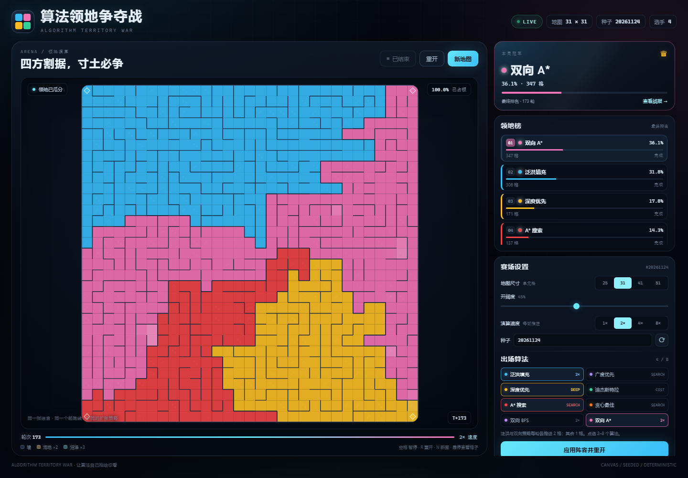

# 算法领地争夺战 · Algorithm Territory War

把 **泛洪填充、BFS、DFS、Dijkstra、A\*、贪心、双向 BFS、双向 A\*** 放进同一张迷宫，让它们同时向外扩张、互相抢格，最后按占领面积排名。



[在线演示](https://myy114.github.io/algorithm-territory-war/) · [GitHub 仓库](https://github.com/MYY114/algorithm-territory-war)

---

## 这个项目是什么

- 一张 2D 迷宫，所有格子天然连通，墙只存在于格子之间。
- 2–8 个算法从不同出生点出发，每轮从自己的 frontier 取格子占领。
- 已被别人占领的格子不能重复占领，抢空会记入 `wasted`。
- 地图被占满、所有算法都卡住，或连续多轮无人扩张时结束。
- 结束后按 `cells`（占领格数）降序排名，`wasted` 少者优先，再按名称排序。
- 纯静态前端，Canvas 2D 渲染，无构建步骤、无第三方依赖。

## 快速开始

直接双击打开 `index.html` 即可。

也可以起一个本地静态服务器：

```bash
# 任选一种
python -m http.server 8000
npx serve .
```

然后访问 `http://localhost:8000/`。

要求：现代 Chromium / Firefox / Safari，支持 Canvas 2D、`Path2D`、`ResizeObserver`。

## 操作

| 操作 | 说明 |
| --- | --- |
| `空格` | 暂停 / 继续 |
| `R` | 用当前地图和阵容重开 |
| `N` | 换一个新种子并生成新地图 |
| 鼠标悬停 | 查看坐标、地形、当前归属 |
| 查看战报 | 打开当前或最终的完整排名 |
| 地图尺寸 | 25 / 31 / 41 / 51 可选 |
| 开阔度 | 0–100%，越高墙越少、环路和广场越多 |
| 演算速度 | 1× / 2× / 4× / 8× |
| 种子 | 相同种子 + 相同阵容可复现同一局 |

## 八种算法

| 算法 | 扩张策略 | 每轮推进 | 颜色 |
| --- | --- | --- | --- |
| 泛洪填充 Flood Fill | 队列式地毯平推 | 2 格 | `#38bdf8` |
| 广度优先 BFS | 一圈一圈均匀扩张 | 1 格 | `#a78bfa` |
| 深度优先 DFS | 栈式深插，容易拉出细长飞地 | 1 格 | `#fbbf24` |
| 迪杰斯特拉 Dijkstra | 按累计地形代价优先扩张 | 1 格 | `#34d399` |
| A\* 搜索 | 代价 + 向地图中心的启发 | 1 格 | `#ef4444` |
| 贪心最佳 Greedy | 只看离中心多远，直线冲刺 | 1 格 | `#f97316` |
| 双向 BFS | 两个队列反向包抄 | 2 格 | `#c084fc` |
| 双向 A\* | 一支扑中心、一支扑最远点 | 2 格 | `#f472b6` |

> 注意：这不是在解同一条最短路，而是把不同 frontier 扩张策略放在同一张图上做可视化对抗。`Dijkstra` 和 `A*` 会计入地形代价，`BFS / DFS / 泛洪 / 贪心` 忽略代价；`双向` 算法维护两个前沿。结果受地图、种子、出生点和阵容影响，不能直接当成算法绝对强弱的结论。

## 地图模型

- 递归回溯生成完美迷宫，再按 `开阔度` 随机打通一部分墙，并挖出 5 个小广场，制造环路和可争夺的开阔地。
- 墙位掩码：`N=1, E=2, S=4, W=8`，墙位于格子边缘，不占格。
- 地形代价：普通 `1`、泥地 `2`、沼泽 `3`。
- 出生点：四角 + 四边中点，共 8 个锚点；按参赛数量选择布局，2 个用对角，4 个用四角，8 个全开。
- 每轮行动顺序由 seeded RNG 打乱；同一个种子和阵容会得到同一局过程与结果。

### 默认四算法基准

`31 × 31`、种子 `20261124`、开阔度 `45%`、阵容 `flood,bidastar,dfs,astar`：

```text
双向 A*    36.1%  (347 格)
泛洪填充   31.8%  (306 格)
深度优先   17.8%  (171 格)
A* 搜索    14.3%  (137 格)
173 轮结束，961 / 961 格被占领
```

## URL 参数

适合分享固定局面或生成稳定截图：

```text
?seed=20261124
&size=31
&braid=45
&speed=2
&algos=flood,bidastar,dfs,astar
&snapshot=1
&ticks=200
&autoplay=0
```

| 参数 | 取值 | 说明 |
| --- | --- | --- |
| `seed` | 任意字符串 | 地图和行动顺序的随机种子 |
| `size` | `25` `31` `41` `51` | 地图边长 |
| `braid` | `0`–`100` | 额外打通墙面的比例 |
| `speed` | `1` `2` `4` `8` | 演算倍速 |
| `algos` | 逗号分隔的算法 id | 例如 `flood,astar` |
| `snapshot` | `1` | 生成后先推进 `ticks` 轮并暂停，适合截图 |
| `ticks` | 整数 | 快照模式推进的轮数，默认 `210` |
| `autoplay` | `0` | 打开后先暂停，不自动开跑 |

固定终局截图示例：

```text
index.html?snapshot=1&ticks=200&size=31&seed=20261124&braid=45&speed=2
```

## 项目结构

```text
.
├── index.html              # 页面与控件
├── styles.css              # 深色霓虹视觉、响应式布局
├── app.js                  # Canvas 渲染、控件、动画、战报
├── core.js                 # UMD 核心：地图、算法、抢占、计分
├── test/smoke.js           # Node 冒烟测试（无需依赖）
├── package.json
├── docs/screenshot.png
├── LICENSE
└── README.md
```

核心逻辑不依赖 DOM，可直接在 Node 中复用：

```js
const C = require('./core.js');
const arena = C.generateArena({ cols: 31, rows: 31, seed: '20261124', braid: 45 });
const match = C.createMatch(arena, C.DEFAULT_ALGORITHMS, '20261124:match');
C.runTicks(match, 320);
console.log(match.snapshot().results);
```

## 测试

```bash
npm test
# 或
node test/smoke.js
```

断言覆盖：地图总格数、房间数量、终局覆盖率、冠军、排名、占领格数总和、同种子重跑一致性。

## 灵感来源

玩法与视觉方向来自抖音 **@编程人生** 的「算法圈地」系列视频：多种算法在同一张图里实时扩张，领地相撞形成边界，最后按面积排名。

原始分享链接：<https://v.douyin.com/szRN6Wsl3ms/>

开发时该链接受平台限制无法直接提取原片，因此本项目是按同系列公开玩法做的**独立实现与策略化演绎**，不是对某一帧画面的逐像素复刻。如果你希望严格对齐视频里的地图尺寸、算法阵容、配色或节奏，可以提供录屏/截图，我可以继续按参考调整。

## License

MIT © 2026 MYY114
